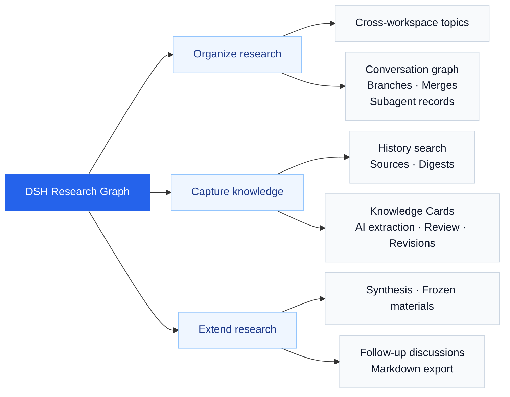
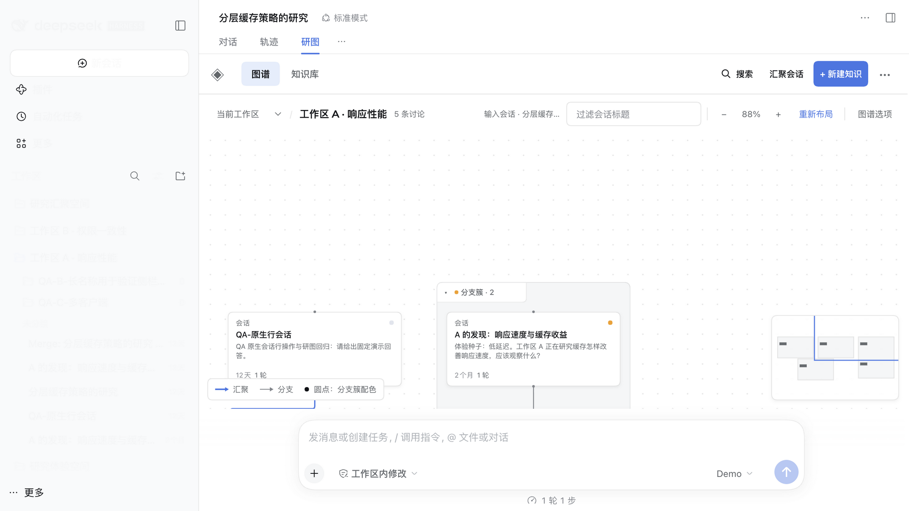

<a id="dsh-research-graph--研图"></a>

# DSH Research Graph

[](https://github.com/benz-ai-x/dsh-research-graph/actions/workflows/ci.yml) [](https://www.npmjs.com/package/@benz-ai-x/dsh-research-graph) [](LICENSE)

**English** | [简体中文](README.zh.md)

An independently maintained, open-source **AI research workbench plugin** for [DeepSeek Harness (DSH)](https://github.com/deepseek-ai/deepseek-harness), running inside **DSH Web**. Organize conversations into research topics and traceable Knowledge Cards for product research, technical research, and ongoing knowledge management.

## Capability map



## Workbench screenshot

<p align="center">
  <a href="docs/assets/readme/research-workbench.png">
    
  </a>
</p>

Version 0.2.2-rc.3 with demo data. Click the image for the full-resolution screenshot.

<a id="features"></a>
<a id="what-it-adds"></a>

## Key capabilities

| Capability | What you can do |
| --- | --- |
| **Research graph** | Organize discussions, inspect branches and merges; drag, collapse, and relayout; cards show turn counts and the inspector reports Session stats |
| **Own sidebar with Workspace folders** | Replaces the official sidebar with this package's copy and adds user-created folders inside each Workspace: create/rename/delete from the workspace menu, drag Sessions in or out, native row menus everywhere. Uninstalling the plugin restores the official sidebar |
| **Source tracing** | Search discussion text and return to the exact original turns |
| **Knowledge capture** | Save conclusions, conditions, and open questions; edit through new revisions |
| **AI analysis** | Extract selected discussion and compare 2–3 materials; review before saving |
| **Follow-up research** | Start from a historical turn or chosen card revision, retaining the materials used |
| **Tasks and delivery** | Inspect existing subagent records and export Markdown research results |

<a id="compatibility"></a>
<a id="dsh-and-agent-presets"></a>

## Key facts

| Item | Details |
| --- | --- |
| Plugin release | [0.2.2-rc.3](https://github.com/benz-ai-x/dsh-research-graph/releases/tag/v0.2.2-rc.3), npm `latest` / `next` |
| Required Host | **DSH 0.2.2-rc.3 · Web**, Node.js `>=24.9.0` |
| Data | Research records and Workspace folders live on the DSH Host; view preferences and working positions stay in the browser, and Topic arrangements require explicit saving |
| Model calls | Browsing, manual capture, and export make no model call; AI generation and new discussions use models on demand |
| Agent capabilities | DSH provides models, tools, presets, and agent execution; this plugin includes no preset or Agent Team launcher. [Details](docs/user-guide.md#dsh-and-agent-presets) |
| Stack and license | TypeScript · React · [MIT](LICENSE) |

<a id="install"></a>

## Quick start

Requires **DSH 0.2.2-rc.3** (Node.js `>=24.9.0`), with both `dsh` and `pnpm` on your `PATH`. Stop any running `dsh web`, then run:

```sh
dsh plugin --profile web add @benz-ai-x/dsh-research-graph@0.2.2-rc.3
dsh web
```

Open the login URL printed in the terminal, enter a **non-blank Session**, and select **Research Graph**: read a source → save knowledge → continue the discussion. See [installation options](docs/user-guide.md#install) if you run DSH through `npx` or from source.

<a id="installable-versions"></a>

## Installable versions

Install a release that matches your DSH Host with `dsh plugin --profile web add @benz-ai-x/dsh-research-graph@<version>`. Each release pins its Host through the exact `@deepseek-ai/dsh-llm` peer, enforced when the profile starts.

| Plugin release | Required DSH | Notes |
| --- | --- | --- |
| `0.2.2-rc.3` | `0.2.2-rc.3` | Current release — reusable Workspace picker Factory and New Session HOC; requires Node.js `>=24.9.0`; npm `latest` / `next` |
| `0.2.2-rc.2` | `0.2.2-rc.2` | Previous release — DSH rc.2 compatibility and Menu anchor migration; requires Node.js `>=24.9.0` |
| `0.2.2-rc.1` | `0.2.2-rc.1` | First adaptation of DSH 0.2.2-rc.1; requires Node.js `>=24.9.0` |
| `0.2.1-rc.5.2` | `0.2.1-rc.5` | **Breaking change**: replaces the official sidebar with the vendored copy and Workspace folders (supersedes sidebar categories; old category data stays dormant) |

See the [full release history](https://github.com/benz-ai-x/dsh-research-graph/releases) or [all npm versions](https://www.npmjs.com/package/@benz-ai-x/dsh-research-graph/versions) for older Host lines and package names.

## Docs and support

[User guide](docs/user-guide.md) · [Troubleshooting](docs/user-guide.md#troubleshooting) · [Development and release](docs/development.md) · [Release acceptance](docs/reviews/release-0.2.2-rc.3.md) · [Report an issue](https://github.com/benz-ai-x/dsh-research-graph/issues)
