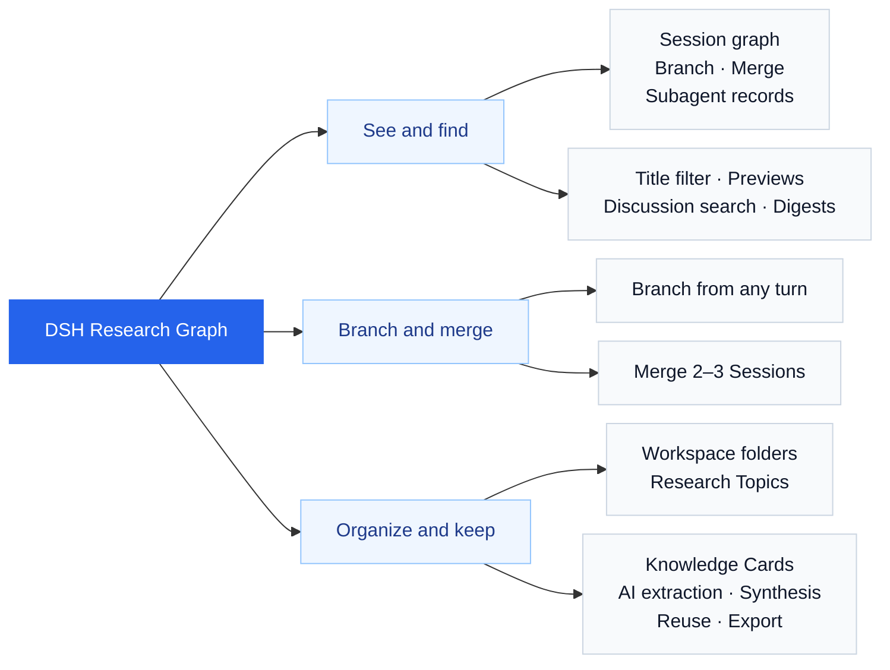
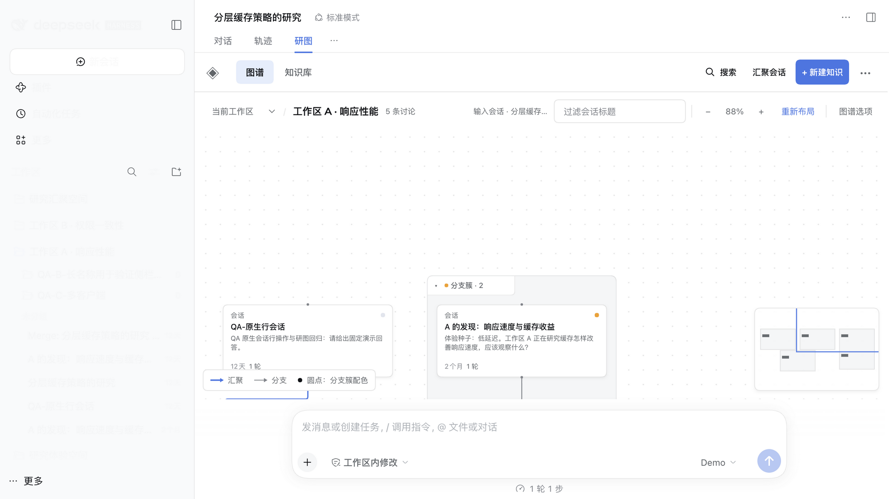

<a id="dsh-research-graph--研图"></a>

# DSH Research Graph

[](https://github.com/benz-ai-x/dsh-research-graph/actions/workflows/ci.yml) [](https://www.npmjs.com/package/@benz-ai-x/dsh-research-graph) [](LICENSE)

**English** | [简体中文](README.zh.md)

Put your DSH Sessions on one canvas: **find the one you need, branch a discussion into parallel directions, and merge the branches back into one conclusion**. **DSH Research Graph** is an independently maintained, open-source **session graph plugin** for [DeepSeek Harness (DSH)](https://github.com/deepseek-ai/deepseek-harness), running inside **DSH Web and DSH Desktop**. It draws each Session with its Branch and Merge relations, adds a folder level to the sidebar, and keeps what you learn as source-linked Knowledge Cards, for technical investigation, product research, and everyday planning such as a trip itinerary.

## Use cases

- **Find a discussion:** filter the canvas by title, preview a card on hover, or search discussion text when you remember what was said but not where.
- **Explore directions in parallel:** branch from a completed turn to try another approach while the source Session stays intact.
- **Converge on a conclusion:** merge 2–3 Sessions into a new one, asking the question you want answered, and keep the Merge relation visible on the canvas.
- **Keep the sidebar tidy:** drag Sessions into Workspace folders, and gather related Sessions from several Workspaces into one Research Topic without moving them.
- **Keep what you learned:** save conclusions as source-linked Knowledge Cards — one card per attraction when planning a trip, for example — then reuse them in a new discussion or export them as Markdown.

## Capability map



## Screenshot

<p align="center">
  <a href="docs/assets/readme/research-workbench.png">
    
  </a>
</p>

Version 0.2.2-rc.3.5 with demo data. Click the image for the full-resolution screenshot.

<a id="features"></a>
<a id="what-it-adds"></a>

## Key capabilities

| Capability | What you can do |
| --- | --- |
| **Session graph and finding** | See a Workspace's Sessions on one canvas with their Branch and Merge relations. Filter by title, search discussion text, preview a card on hover, or generate a digest to decide which one to open; drag, collapse, and relayout without changing any source Session |
| **Branch from any turn** | Choose Branch from here on a completed turn: the new Session inherits the turns before it and continues with your new question while the source stays intact. Create another branch to take another direction |
| **Merge Sessions** | Pick 2–3 Sessions, write a question, and choose the destination Workspace and model. Harness creates one independent Session from a snapshot of each source, and the canvas keeps the Merge relation |
| **Sidebar with Workspace folders** | The plugin's own sidebar replaces the official one and adds a folder level: Workspace → folder → Session. Drag Sessions into folders, keep the native menu on every Session row, and uninstall to restore the official sidebar |
| **Research Topics** | Group Sessions across Workspaces without moving them, and return to the exact original turns behind a finding |
| **Knowledge Cards** | Save conclusions with exact sources, by hand or through reviewed AI extraction such as one card per attraction. Reuse cards in a new discussion, compare 2–3 materials, and export Markdown |

<a id="compatibility"></a>
<a id="dsh-and-agent-presets"></a>

## Key facts

| Item | Details |
| --- | --- |
| Plugin release | [0.2.3-alpha.2](https://github.com/benz-ai-x/dsh-research-graph/releases/tag/v0.2.3-alpha.2) for DSH `0.2.3-alpha.2` (npm `next`) · [0.2.2-rc.5](https://github.com/benz-ai-x/dsh-research-graph/releases/tag/v0.2.2-rc.5) for DSH `0.2.2-rc.5` (npm `latest`) |
| Required Host | **The DSH version the installed plugin release was built for**: `0.2.3-alpha.2` with Node.js `^24.22.3 \|\| >=26.13.1`, or `0.2.2-rc.5` with Node.js `>=24.9.0` · Web and Desktop |
| Data | Research records and Workspace folders live on the DSH Host; view preferences and working positions stay in the browser, and Topic arrangements require explicit saving |
| Model calls | Browsing, manual capture, and export make no model call; AI generation and new discussions use models on demand |
| <a id="enable-discussion-search"></a>Discussion search | Uses DSH full-text indexing, which DSH `0.2.3-alpha.2` turns off by default. If search reports that indexing is off, follow [Enable discussion search](docs/user-guide.md#enable-discussion-search) |
| Agent capabilities | DSH provides models, tools, presets, and agent execution; this plugin includes no preset or Agent Team launcher. [Details](docs/user-guide.md#dsh-and-agent-presets) |
| Stack and license | TypeScript · React · [MIT](LICENSE) |

## Frequently asked questions

### How is DSH Research Graph different from ordinary AI chat history?

A chat history is a list: it does not show which Session branched from which, or which discussions were merged into one conclusion. Research Graph draws those relations on one canvas and lets you act on them — find a Session, branch from a turn, merge 2–3 Sessions — then keeps the work organized with Workspace folders, Research Topics, and Knowledge Cards. It complements the native DSH conversation instead of replacing its original history.

### Does it require a separate app or service?

No. Research Graph installs as a plugin inside a compatible **DSH Web or Desktop** Host; the DSH profile still owns Session execution and model services.

### Where are research records stored?

Research Topics, Knowledge Card revisions, Reuse records, and Workspace folders are stored on the DSH Host. Browser-local working positions and unsaved arrangements remain separate; original Session logs stay in Harness.

### When does it call an AI model?

Browsing, searching, manual capture, and Markdown export make no model call. AI extraction, synthesis, title or digest generation, and new discussions use models only when explicitly requested.

<a id="install"></a>

## Quick start

Each plugin release runs only on the DSH version it was built for. Check yours with `dsh --version`, stop any running `dsh web`, then install the matching release with both `dsh` and `pnpm` on your `PATH`:

```sh
# DSH 0.2.2-rc.5 (npm `latest`)
dsh plugin --profile web add @benz-ai-x/dsh-research-graph@0.2.2-rc.5
dsh web
```

```sh
# DSH 0.2.3-alpha.2 (npm `next`)
dsh plugin --profile web add @benz-ai-x/dsh-research-graph@0.2.3-alpha.2
dsh web
```

In **DSH Desktop**, add the release that matches the application version from its **Plugins** page, or follow the [Desktop install steps](docs/user-guide.md#install-in-dsh-desktop).

> **Not this package:** the unscoped npm package `dsh-research-graph` is another author's finance research plugin. This project publishes only as `@benz-ai-x/dsh-research-graph`.

Open the login URL printed in the terminal, enter a **non-blank Session**, and select **Research Graph**: hover a card to preview it → open a Session and choose **Branch from here** on a completed turn → choose **Merge sessions** to bring the branches back together. See [installation options](docs/user-guide.md#install) if you run DSH through `npx` or from source.

<a id="installable-versions"></a>

## Installable versions

Install a release that matches your DSH Host with `dsh plugin --profile web add @benz-ai-x/dsh-research-graph@<version>`. Each release pins its Host through the exact `@deepseek-ai/dsh-llm` peer, enforced when the profile starts.

| Plugin release | Required DSH | Notes |
| --- | --- | --- |
| `0.2.3-alpha.2` | `0.2.3-alpha.2` | Current release — retires plugin-owned Session Backup/Restore and adopts the new Host runtime floor; requires Node.js `^24.22.3 \|\| >=26.13.1`; npm `next` |
| `0.2.3-alpha.1` | `0.2.3-alpha.1` | Previous release — new Host Session status service, current-directory projection, and factual unread/failed presentation; requires Node.js `>=24.9.0` |
| `0.2.2-rc.5` | `0.2.2-rc.5` | DSH rc.5 adaptation with provider-refusal regression coverage; requires Node.js `>=24.9.0`; npm `latest` |
| `0.2.2-rc.3.5` | `0.2.2-rc.3` | Host-linked extraction model selection plus richer Knowledge Card filtering, badges, and grouped source reading; requires Node.js `>=24.9.0` |
| `0.2.2-rc.3.4` | `0.2.2-rc.3` | Reviewed Selected Session extraction with exact sources; requires Node.js `>=24.9.0` |
| `0.2.2-rc.3.3` | `0.2.2-rc.3` | Native Session backup and on-demand restore with Workspace-aware filenames and no overwriting; requires Node.js `>=24.9.0` |
| `0.2.2-rc.3.2` | `0.2.2-rc.3` | Restores unaccounted Sessions when re-adding the same Workspace directory; requires Node.js `>=24.9.0` |
| `0.2.2-rc.3.1` | `0.2.2-rc.3` | Restores Branch links for independent ordinary forks; requires Node.js `>=24.9.0` |
| `0.2.2-rc.3` | `0.2.2-rc.3` | Reusable Workspace picker Factory and New Session HOC; requires Node.js `>=24.9.0` |
| `0.2.2-rc.2` | `0.2.2-rc.2` | Previous release — DSH rc.2 compatibility and Menu anchor migration; requires Node.js `>=24.9.0` |
| `0.2.2-rc.1` | `0.2.2-rc.1` | First adaptation of DSH 0.2.2-rc.1; requires Node.js `>=24.9.0` |
| `0.2.1-rc.5.2` | `0.2.1-rc.5` | **Breaking change**: replaces the official sidebar with the vendored copy and Workspace folders (supersedes sidebar categories; old category data stays dormant) |

See the [full release history](https://github.com/benz-ai-x/dsh-research-graph/releases) or [all npm versions](https://www.npmjs.com/package/@benz-ai-x/dsh-research-graph/versions) for older Host lines and package names.

## Docs and support

[User guide](docs/user-guide.md) · [Troubleshooting](docs/user-guide.md#troubleshooting) · [Development and release](docs/development.md) · [Release acceptance](docs/reviews/release-0.2.3-alpha.2.md) · [Report an issue](https://github.com/benz-ai-x/dsh-research-graph/issues)
