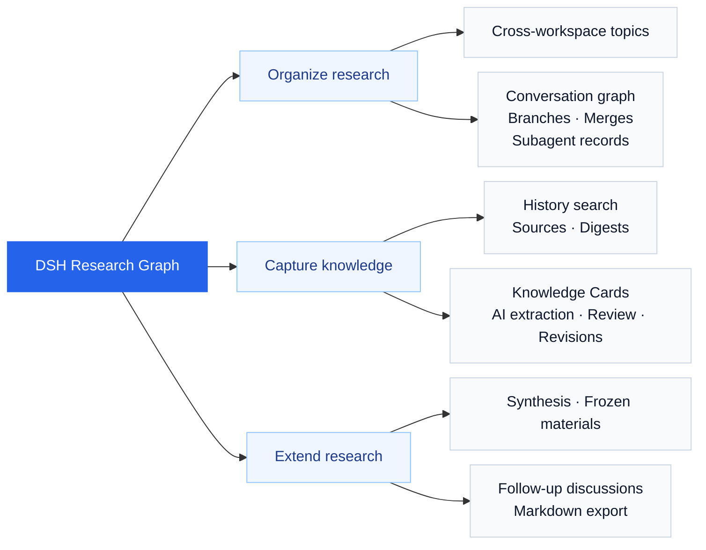

<a id="dsh-research-graph--研图"></a>

# DSH Research Graph

[](https://github.com/benz-ai-x/dsh-research-graph/actions/workflows/ci.yml) [](https://www.npmjs.com/package/@benz-ai-x/dsh-research-graph) [](LICENSE)

**English** | [简体中文](README.zh.md)

Turn scattered AI conversations into a **visual, traceable, reusable research knowledge base**. **DSH Research Graph** is an independently maintained, open-source **AI research workbench plugin** for [DeepSeek Harness (DSH)](https://github.com/deepseek-ai/deepseek-harness), running inside **DSH Web**. Map conversation branches and merges, connect research across Workspaces, and turn selected discussion turns into source-linked Knowledge Cards for product research, technical investigation, and ongoing knowledge management.

## Use cases

- **Technical investigation:** compare design branches, retain the evidence behind each conclusion, and resume from a selected historical turn.
- **Product research:** gather findings from several Workspaces into one Research Topic without moving or rewriting source Sessions.
- **Research knowledge management:** turn completed discussions into reviewed Knowledge Cards with exact source ranges, revisions, and open questions.
- **Follow-up research:** reuse frozen cards and discussion ranges in a new Session, compare 2–3 materials, and export results as Markdown.

## Capability map



## Workbench screenshot

<p align="center">
  <a href="docs/assets/readme/research-workbench.png">
    
  </a>
</p>

Version 0.2.2-rc.3.1 with demo data. Click the image for the full-resolution screenshot.

<a id="features"></a>
<a id="what-it-adds"></a>

## Key capabilities

| Capability | What you can do |
| --- | --- |
| **Visual conversation graph** | See how discussions fork and merge, show verified ordinary-fork Branch links, and inspect existing Subagent work; drag, collapse, and relayout without changing source Sessions |
| **Own sidebar with Workspace folders** | Organize Sessions in user-created folders inside each Workspace while retaining native row menus. Create, rename, delete, and drag members; uninstalling restores the official sidebar |
| **Research Topics and source tracing** | Gather discussions across Workspaces, search discussion text, and return to the exact original turns behind a finding |
| **Source-linked Knowledge Cards** | Save reviewed conclusions, conditions, and open questions with exact sources; edit through new revisions without losing earlier versions |
| **AI extraction and synthesis** | Extract selected turns and compare 2–3 frozen materials; inspect drafts and citations before explicitly saving |
| **Follow-up research** | Start from a historical turn or reuse chosen card revisions and discussion ranges, retaining the exact materials used |
| **Inspection and delivery** | Read turn counts and Session statistics, inspect existing Subagent records, and export Markdown research results |

<a id="compatibility"></a>
<a id="dsh-and-agent-presets"></a>

## Key facts

| Item | Details |
| --- | --- |
| Plugin release | [0.2.2-rc.3.1](https://github.com/benz-ai-x/dsh-research-graph/releases/tag/v0.2.2-rc.3.1), npm `next` |
| Required Host | **DSH 0.2.2-rc.3 · Web**, Node.js `>=24.9.0` |
| Data | Research records and Workspace folders live on the DSH Host; view preferences and working positions stay in the browser, and Topic arrangements require explicit saving |
| Model calls | Browsing, manual capture, and export make no model call; AI generation and new discussions use models on demand |
| Agent capabilities | DSH provides models, tools, presets, and agent execution; this plugin includes no preset or Agent Team launcher. [Details](docs/user-guide.md#dsh-and-agent-presets) |
| Stack and license | TypeScript · React · [MIT](LICENSE) |

## Frequently asked questions

### How is DSH Research Graph different from ordinary AI chat history?

It adds a visual map of Branch and Merge relations, cross-Workspace Research Topics, source-linked Knowledge Cards, and reusable frozen materials. It complements the native DSH conversation instead of replacing its original history.

### Does it require a separate workbench service?

No. Research Graph installs as a plugin inside a compatible **DSH Web** Host; the DSH profile still owns Session execution and model services.

### Where are research records stored?

Research Topics, Knowledge Card revisions, Reuse records, and Workspace folders are stored on the DSH Host. Browser-local working positions and unsaved arrangements remain separate; original Session logs stay in Harness.

### When does it call an AI model?

Browsing, searching, manual capture, and Markdown export make no model call. AI extraction, synthesis, title or digest generation, and new discussions use models only when explicitly requested.

<a id="install"></a>

## Quick start

Requires **DSH 0.2.2-rc.3** (Node.js `>=24.9.0`), with both `dsh` and `pnpm` on your `PATH`. Stop any running `dsh web`, then run:

```sh
dsh plugin --profile web add @benz-ai-x/dsh-research-graph@0.2.2-rc.3.1
dsh web
```

Open the login URL printed in the terminal, enter a **non-blank Session**, and select **Research Graph**: read a source → save knowledge → continue the discussion. See [installation options](docs/user-guide.md#install) if you run DSH through `npx` or from source.

<a id="installable-versions"></a>

## Installable versions

Install a release that matches your DSH Host with `dsh plugin --profile web add @benz-ai-x/dsh-research-graph@<version>`. Each release pins its Host through the exact `@deepseek-ai/dsh-llm` peer, enforced when the profile starts.

| Plugin release | Required DSH | Notes |
| --- | --- | --- |
| `0.2.2-rc.3.1` | `0.2.2-rc.3` | Current release — restores Branch links for independent ordinary forks; requires Node.js `>=24.9.0`; npm `next` |
| `0.2.2-rc.3` | `0.2.2-rc.3` | Reusable Workspace picker Factory and New Session HOC; requires Node.js `>=24.9.0` |
| `0.2.2-rc.2` | `0.2.2-rc.2` | Previous release — DSH rc.2 compatibility and Menu anchor migration; requires Node.js `>=24.9.0` |
| `0.2.2-rc.1` | `0.2.2-rc.1` | First adaptation of DSH 0.2.2-rc.1; requires Node.js `>=24.9.0` |
| `0.2.1-rc.5.2` | `0.2.1-rc.5` | **Breaking change**: replaces the official sidebar with the vendored copy and Workspace folders (supersedes sidebar categories; old category data stays dormant) |

See the [full release history](https://github.com/benz-ai-x/dsh-research-graph/releases) or [all npm versions](https://www.npmjs.com/package/@benz-ai-x/dsh-research-graph/versions) for older Host lines and package names.

## Docs and support

[User guide](docs/user-guide.md) · [Troubleshooting](docs/user-guide.md#troubleshooting) · [Development and release](docs/development.md) · [Release acceptance](docs/reviews/release-0.2.2-rc.3.1.md) · [Report an issue](https://github.com/benz-ai-x/dsh-research-graph/issues)
