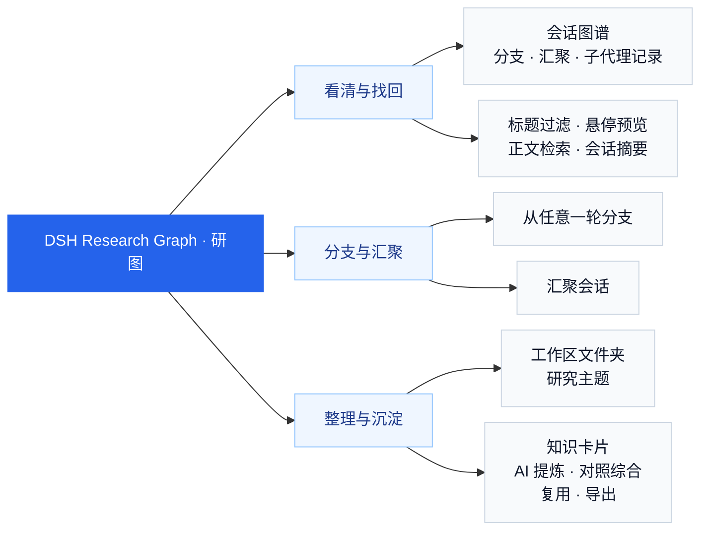

<a id="dsh-research-graph--研图"></a>

# DSH Research Graph · 研图

[](https://github.com/benz-ai-x/dsh-research-graph/actions/workflows/ci.yml) [](https://www.npmjs.com/package/@benz-ai-x/dsh-research-graph) [](LICENSE)

[English](README.md) | **简体中文**

把 DSH 会话放上同一张画布：**找回要的那一个，从一轮讨论分出多条分支，再把分支汇合成一个结论**。**DSH Research Graph · 研图**是面向 [DeepSeek Harness（DSH）](https://github.com/deepseek-ai/deepseek-harness)、由社区独立维护的开源**会话图谱插件**，运行于 **DSH Web 与 DSH Desktop**。它画出每个会话的分支与汇聚关系，为侧栏加上一层文件夹，并把得出的成果留成带来源的知识卡片，适用于技术调研、产品研究，也适用于行程规划这类日常安排。

## 适用场景

- **找回讨论：**只记得聊过什么、不记得在哪个会话时，按标题过滤画布、悬停预览卡片，或检索讨论正文。
- **分头探索：**在已完成的轮次上分支，换一种思路继续，来源会话保持原样。
- **汇合成结论：**带着想问的问题把 2–3 个会话汇合成一个新会话，汇聚关系留在画布上。
- **整理侧栏：**把会话拖进工作区文件夹，并把多个工作区里相关的会话收进同一个研究主题，无需移动它们。
- **留下成果：**把结论存成带来源的知识卡片，比如规划行程时一个景点一张卡，之后带进新讨论或导出为 Markdown。

## 功能能力图谱



## 功能截图

<p align="center">
  <a href="docs/assets/readme/research-workbench.png">
    
  </a>
</p>

0.2.2-rc.3.5 的真实界面（演示数据），点击图片查看高清原图。

<a id="核心能力"></a>

## 关键能力

| 能力 | 你可以做什么 |
| --- | --- |
| **会话图谱与找回** | 在同一张画布上查看工作区的会话及其分支与汇聚关系。按标题过滤、检索讨论正文、悬停预览卡片，或先生成摘要再决定打开哪一个；拖动、折叠与重排不会改变任何来源会话 |
| **从任意一轮分支** | 在已完成的轮次上选择「从此处分支」：新会话继承之前的轮次，带着你的新问题继续，来源会话保持原样。「另建一个分支」换一个方向 |
| **汇聚会话** | 选择 2–3 个会话，写下问题，指定目标工作区与模型。Harness 基于每个来源的快照创建一个独立会话，画布上保留汇聚关系 |
| **带工作区文件夹的侧栏** | 插件以自带侧栏替换官方侧栏，并加一层文件夹：工作区 → 文件夹 → 会话。把会话拖进文件夹，每个会话行保留原生菜单，卸载即还原官方侧栏 |
| **研究主题** | 跨工作区归拢会话而无需移动它们，并回到结论对应的准确原文轮次 |
| **知识卡片** | 手工保存或经审核的 AI 提炼，结论带准确来源，例如一个景点一张卡；可带进新讨论、对照 2–3 份材料，并导出 Markdown |

<a id="兼容性"></a>
<a id="dsh-与-agent-预设"></a>

## 关键信息

| 项目 | 说明 |
| --- | --- |
| 当前插件 | 适配 DSH `0.2.3-alpha.2` 的 [0.2.3-alpha.2](https://github.com/benz-ai-x/dsh-research-graph/releases/tag/v0.2.3-alpha.2)（npm `next`）· 适配 DSH `0.2.2-rc.5` 的 [0.2.2-rc.5](https://github.com/benz-ai-x/dsh-research-graph/releases/tag/v0.2.2-rc.5)（npm `latest`） |
| 适配宿主 | **所用插件版本对应的 DSH 版本**：`0.2.3-alpha.2` 搭配 Node.js `^24.22.3 \|\| >=26.13.1`，或 `0.2.2-rc.5` 搭配 Node.js `>=24.9.0` · Web 与 Desktop |
| 数据保存 | 研究数据与工作区文件夹保存在 DSH Host；视图偏好和工作位置保存在浏览器，主题排列需显式保存 |
| 模型调用 | 浏览、手工留卡与导出不调用模型；AI 生成与新讨论按需调用 |
| <a id="enable-discussion-search"></a>正文检索 | 依赖 DSH 全文索引，而 DSH `0.2.3-alpha.2` 默认关闭该索引；搜索提示索引未启用时，按[启用讨论搜索](docs/user-guide.zh.md#enable-discussion-search)操作 |
| Agent 能力 | 模型、工具、预设与 Agent 执行由 DSH 提供；插件不内置预设或 Agent Team 启动器。[详细说明](docs/user-guide.zh.md#dsh-与-agent-预设) |
| 技术与许可 | TypeScript · React · [MIT](LICENSE) |

## 常见问题

### 研图与普通 AI 聊天记录有什么不同？

聊天记录是一个列表，看不出哪个会话从哪个分支而来、哪几个讨论被汇合成了一个结论。研图把这些关系画在同一张画布上，并让你直接在上面操作——找回会话、从某一轮分支、汇合 2–3 个会话——再用工作区文件夹、研究主题和知识卡片把工作整理好。它补充原生 DSH 会话能力，而不是替换或改写原始历史。

### 需要单独部署应用或服务吗？

不需要。研图作为插件安装在兼容的 **DSH Web 或 Desktop** 宿主中，Session 执行和模型服务仍由 DSH profile 持有。

### 研究数据保存在哪里？

研究主题、知识卡片修订、材料沿用记录和工作区文件夹保存在 DSH Host；浏览器工作位置和未保存排列单独保留，原始 Session 日志仍由 Harness 管理。

### 什么时候会调用 AI 模型？

浏览、搜索、手工留卡与 Markdown 导出不调用模型；AI 提炼、对照综合、标题或摘要生成以及新讨论只在明确操作时按需调用。

<a id="安装"></a>

## 快速开始

每个插件版本只能在它所适配的 DSH 版本上运行。先用 `dsh --version` 确认宿主版本，停止正在运行的 `dsh web`，再确保 `dsh`、`pnpm` 均在 `PATH` 中并安装对应版本：

```sh
# DSH 0.2.2-rc.5（npm `latest`）
dsh plugin --profile web add @benz-ai-x/dsh-research-graph@0.2.2-rc.5
dsh web
```

```sh
# DSH 0.2.3-alpha.2（npm `next`）
dsh plugin --profile web add @benz-ai-x/dsh-research-graph@0.2.3-alpha.2
dsh web
```

使用 **DSH Desktop** 时，在应用的**插件**页面添加与应用版本一致的插件版本，或按[桌面端安装步骤](docs/user-guide.zh.md#在-dsh-desktop-中安装)操作。

> **不是本包：**npm 上不带作用域的 `dsh-research-graph` 是另一位作者的金融研究插件。本项目只发布为 `@benz-ai-x/dsh-research-graph`。

打开终端给出的登录入口，在一个**非空会话**中选择**研图**：悬停卡片预览 → 打开一个会话，在已完成的轮次上选择「从此处分支」→ 选择「汇聚会话」把分支汇合回来。通过 `npx` 或源码运行 DSH 时，参阅[安装方式](docs/user-guide.zh.md#安装)。

<a id="可安装版本"></a>

## 可安装版本

请按本机 DSH 宿主版本安装：`dsh plugin --profile web add @benz-ai-x/dsh-research-graph@<版本>`。每个版本都通过精确的 `@deepseek-ai/dsh-llm` peer 钉版，profile 启动时会强制校验。

| 插件版本 | 要求的 DSH | 备注 |
| --- | --- | --- |
| `0.2.3-alpha.2` | `0.2.3-alpha.2` | 当前版本——退役插件自有会话备份/恢复并跟随宿主新的运行时要求，要求 Node.js `^24.22.3 \|\| >=26.13.1`；npm `next` |
| `0.2.3-alpha.1` | `0.2.3-alpha.1` | 上一版本——适配宿主 Session 状态服务、当前目录 projection 与更准确的未读/失败展示，要求 Node.js `>=24.9.0` |
| `0.2.2-rc.5` | `0.2.2-rc.5` | 适配 DSH rc.5 并覆盖提供方拒答回归，要求 Node.js `>=24.9.0`；npm `latest` |
| `0.2.2-rc.3.5` | `0.2.2-rc.3` | Host 目录联动的提炼模型选择，以及更丰富的知识卡片筛选、徽章和分组来源阅读，要求 Node.js `>=24.9.0` |
| `0.2.2-rc.3.4` | `0.2.2-rc.3` | 审核选定会话的提炼结果并保留准确来源，要求 Node.js `>=24.9.0` |
| `0.2.2-rc.3.3` | `0.2.2-rc.3` | 原生会话备份与按需恢复，文件名包含工作区且不覆盖现有会话，要求 Node.js `>=24.9.0` |
| `0.2.2-rc.3.2` | `0.2.2-rc.3` | 同目录重新添加工作区时恢复未归属会话，要求 Node.js `>=24.9.0` |
| `0.2.2-rc.3.1` | `0.2.2-rc.3` | 恢复独立普通 fork 的分支连线，要求 Node.js `>=24.9.0` |
| `0.2.2-rc.3` | `0.2.2-rc.3` | 可复用 Workspace Picker Factory 与新会话 HOC，要求 Node.js `>=24.9.0` |
| `0.2.2-rc.2` | `0.2.2-rc.2` | 上一版本——适配 DSH rc.2 并迁移 Menu 锚点，要求 Node.js `>=24.9.0` |
| `0.2.2-rc.1` | `0.2.2-rc.1` | DSH 0.2.2-rc.1 首次适配，要求 Node.js `>=24.9.0` |
| `0.2.1-rc.5.2` | `0.2.1-rc.5` | **破坏性变更**：以自带侧栏替换官方侧栏并提供工作区文件夹（取代侧栏分类，旧分类数据保留但不再显示） |

更早的宿主版本与历史包名请查[完整发布记录](https://github.com/benz-ai-x/dsh-research-graph/releases)或 [npm 全部版本](https://www.npmjs.com/package/@benz-ai-x/dsh-research-graph/versions)。

## 文档与支持

[使用指南](docs/user-guide.zh.md) · [故障排查](docs/user-guide.zh.md#故障排查) · [开发与发布](docs/development.zh.md) · [发布验收](docs/reviews/release-0.2.3-alpha.2.md) · [问题反馈](https://github.com/benz-ai-x/dsh-research-graph/issues)
