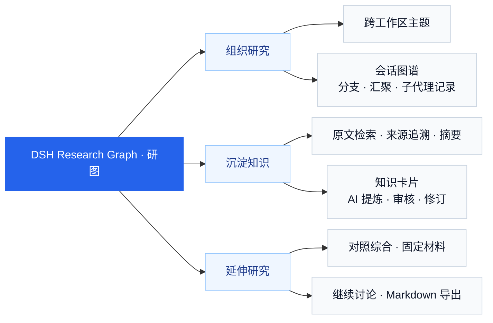
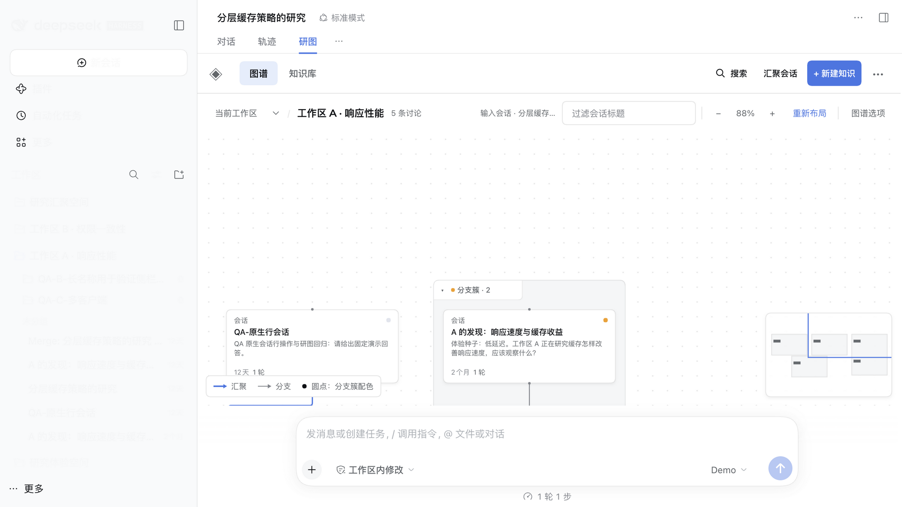

<a id="dsh-research-graph--研图"></a>

# DSH Research Graph · 研图

[](https://github.com/benz-ai-x/dsh-research-graph/actions/workflows/ci.yml) [](https://www.npmjs.com/package/@benz-ai-x/dsh-research-graph) [](LICENSE)

[English](README.md) | **简体中文**

把分散的 AI 对话转化为**可视化、可追溯、可持续复用的研究知识库**。**DSH Research Graph · 研图**是面向 [DeepSeek Harness（DSH）](https://github.com/deepseek-ai/deepseek-harness)、由社区独立维护的开源 **AI 研究工作台插件**，运行于 **DSH Web**。呈现会话分支与汇聚关系，跨工作区连接研究主题，并将选定讨论轮次转化为带来源的知识卡片，适用于产品研究、技术调研与持续知识管理。

## 适用场景

- **技术调研：**比较不同设计分支，保留结论背后的证据，并从选定的历史轮次继续研究。
- **产品研究：**将多个工作区中的发现汇入同一研究主题，无需移动或改写来源会话。
- **研究知识管理：**把已完成讨论整理为经过审核的知识卡片，保留准确的原文范围、修订与待验证问题。
- **后续研究：**在新会话中复用冻结的卡片和讨论范围，对照 2–3 份材料，并将结果导出为 Markdown。

## 功能能力图谱



## 功能截图

<p align="center">
  <a href="docs/assets/readme/research-workbench.png">
    
  </a>
</p>

0.2.2-rc.3.2 的真实界面（演示数据），点击图片查看高清原图。

<a id="核心能力"></a>

## 关键能力

| 能力 | 你可以做什么 |
| --- | --- |
| **可视化会话图谱** | 直观看清讨论如何分叉与汇聚，显示经过验证的普通 fork 分支关系，并检查已有子代理工作；拖动、折叠与重排不会改变来源会话 |
| **自有侧栏与工作区文件夹** | 在工作区内创建文件夹整理会话，同时保留原生会话行菜单；同目录重新添加已移除的工作区时恢复当前未归属会话，卸载插件即还原官方侧栏 |
| **研究主题与来源追溯** | 跨工作区汇集讨论，检索讨论正文，并回到发现所对应的准确原文轮次 |
| **带来源的知识卡片** | 保存经过审核的结论、适用条件和待验证问题，并保留准确来源；编辑形成新修订，不丢失历史版本 |
| **AI 提炼与对照综合** | 提炼选定轮次，对照 2–3 份冻结材料；检查草稿与引用后再明确保存 |
| **后续研究** | 从历史轮次开始，或复用选定的卡片修订与讨论范围，准确保留当时使用的材料 |
| **检查与交付** | 查看轮数与会话统计，检查已有子代理记录，并导出 Markdown 研究成果 |

<a id="兼容性"></a>
<a id="dsh-与-agent-预设"></a>

## 关键信息

| 项目 | 说明 |
| --- | --- |
| 当前插件 | [0.2.2-rc.3.2](https://github.com/benz-ai-x/dsh-research-graph/releases/tag/v0.2.2-rc.3.2)，npm `latest` / `next` |
| 适配宿主 | **DSH 0.2.2-rc.3 · Web**，Node.js `>=24.9.0` |
| 数据保存 | 研究数据与工作区文件夹保存在 DSH Host；视图偏好和工作位置保存在浏览器，主题排列需显式保存 |
| 模型调用 | 浏览、手工留卡、导出不调用模型；AI 生成与新讨论按需调用 |
| Agent 能力 | 模型、工具、预设与 Agent 执行由 DSH 提供；插件不内置预设或 Agent Team 启动器。[详细说明](docs/user-guide.zh.md#dsh-与-agent-预设) |
| 技术与许可 | TypeScript · React · [MIT](LICENSE) |

## 常见问题

### 研图与普通 AI 聊天记录有什么不同？

研图增加可视化的分支与汇聚关系、跨工作区研究主题、带来源的知识卡片和可复用的冻结材料。它补充原生 DSH 会话能力，而不是替换或改写原始历史。

### 需要单独部署工作台服务吗？

不需要。研图作为插件安装在兼容的 **DSH Web** 宿主中，Session 执行和模型服务仍由 DSH profile 持有。

### 研究数据保存在哪里？

研究主题、知识卡片修订、材料沿用记录和工作区文件夹保存在 DSH Host；浏览器工作位置和未保存排列单独保留，原始 Session 日志仍由 Harness 管理。

### 什么时候会调用 AI 模型？

浏览、搜索、手工留卡和 Markdown 导出不调用模型；AI 提炼、对照综合、标题或摘要生成以及新讨论只在明确操作时按需调用。

<a id="安装"></a>

## 快速开始

需要 **DSH 0.2.2-rc.3**（Node.js `>=24.9.0`），并确保 `dsh`、`pnpm` 均在 `PATH` 中。如有正在运行的 `dsh web`，先停止，再执行：

```sh
dsh plugin --profile web add @benz-ai-x/dsh-research-graph@0.2.2-rc.3.2
dsh web
```

打开终端给出的登录入口，在一个**非空会话**中选择**研图**：读原文 → 保存知识 → 继续讨论。通过 `npx` 或源码运行 DSH 时，参阅[安装方式](docs/user-guide.zh.md#安装)。

<a id="可安装版本"></a>

## 可安装版本

请按本机 DSH 宿主版本安装：`dsh plugin --profile web add @benz-ai-x/dsh-research-graph@<版本>`。每个版本都通过精确的 `@deepseek-ai/dsh-llm` peer 钉版，profile 启动时会强制校验。

| 插件版本 | 要求的 DSH | 备注 |
| --- | --- | --- |
| `0.2.2-rc.3.2` | `0.2.2-rc.3` | 当前版本——同目录重新添加工作区时恢复未归属会话，要求 Node.js `>=24.9.0`；npm `latest` / `next` |
| `0.2.2-rc.3.1` | `0.2.2-rc.3` | 恢复独立普通 fork 的分支连线，要求 Node.js `>=24.9.0` |
| `0.2.2-rc.3` | `0.2.2-rc.3` | 可复用 Workspace Picker Factory 与新会话 HOC，要求 Node.js `>=24.9.0` |
| `0.2.2-rc.2` | `0.2.2-rc.2` | 上一版本——适配 DSH rc.2 并迁移 Menu 锚点，要求 Node.js `>=24.9.0` |
| `0.2.2-rc.1` | `0.2.2-rc.1` | DSH 0.2.2-rc.1 首次适配，要求 Node.js `>=24.9.0` |
| `0.2.1-rc.5.2` | `0.2.1-rc.5` | **破坏性变更**：以自带侧栏替换官方侧栏并提供工作区文件夹（取代侧栏分类，旧分类数据保留但不再显示） |

更早的宿主版本与历史包名请查[完整发布记录](https://github.com/benz-ai-x/dsh-research-graph/releases)或 [npm 全部版本](https://www.npmjs.com/package/@benz-ai-x/dsh-research-graph/versions)。

## 文档与支持

[使用指南](docs/user-guide.zh.md) · [故障排查](docs/user-guide.zh.md#故障排查) · [开发与发布](docs/development.zh.md) · [发布验收](docs/reviews/release-0.2.2-rc.3.2.md) · [问题反馈](https://github.com/benz-ai-x/dsh-research-graph/issues)
