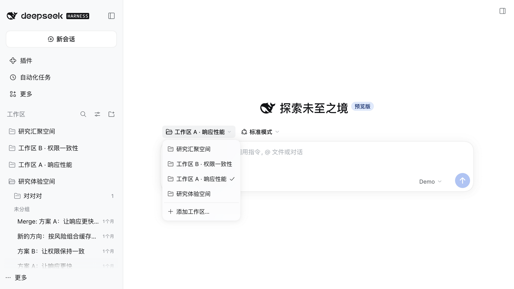

# DSH 0.2.2-rc.2 compatibility analysis

PR [#85](https://github.com/benz-ai-x/dsh-research-graph/pull/85) adapts Research Graph from DSH `0.2.2-rc.1` to `0.2.2-rc.2` without changing product behavior.

## Scope and method

- Old upstream: `dsh-v0.2.2-rc.1`, commit `66491b05e3f05ad35bcdd4f6cd7ed26041d9e3db`.
- New upstream: `dsh-v0.2.2-rc.2`, commit `ddac96760b6edf8fa0fe17cbdcf0b512f4c12b2c`.
- The range contains 1,568 commits. The analysis starts from `package.json`'s `dsh.client.inject`, direct dependencies and exact LLM peer, then scans imports in `src/`, `types/`, `tests/`, `scripts/`, bundler externals, and the vendored provenance in `VENDORED.md`.
- Each row below records **changed / unchanged / uncertain** for the plugin's consumed contract, not for every internal implementation in the upstream package. Paths and line numbers refer to the rc.2 checkout. No uncertain rows remain after the compiler and runtime gates.

## Coverage inventory

```text
@deepseek-ai/dsh-agent                    @deepseek-ai/dsh-agent-default-model
@deepseek-ai/dsh-agent-preset-registry    @deepseek-ai/dsh-api-gateway
@deepseek-ai/dsh-api-remote-access        @deepseek-ai/dsh-api-remotes
@deepseek-ai/dsh-api-session-controller   @deepseek-ai/dsh-api-workspace-controller
@deepseek-ai/dsh-attachment               @deepseek-ai/dsh-client-connection
@deepseek-ai/dsh-client-locale            @deepseek-ai/dsh-client-product-analytics
@deepseek-ai/dsh-client-shortcuts         @deepseek-ai/dsh-client-store
@deepseek-ai/dsh-client-test-runtime      @deepseek-ai/dsh-client-ui-context-menu (indirect)
@deepseek-ai/dsh-client-ui-conversation   @deepseek-ai/dsh-client-ui-dockkit (build external)
@deepseek-ai/dsh-client-ui-layout         @deepseek-ai/dsh-client-ui-primitives
@deepseek-ai/dsh-client-ui-renderer       @deepseek-ai/dsh-client-ui-session
@deepseek-ai/dsh-client-ui-sidebar        @deepseek-ai/dsh-client-ui-slots
@deepseek-ai/dsh-client-ui-workspace      @deepseek-ai/dsh-error
@deepseek-ai/dsh-goal                     @deepseek-ai/dsh-jobs
@deepseek-ai/dsh-llm                      @deepseek-ai/dsh-package-manifest
@deepseek-ai/dsh-schedule                 @deepseek-ai/dsh-session
@deepseek-ai/dsh-session-format-catalog   @deepseek-ai/dsh-session-persistence
@deepseek-ai/dsh-session-persistence-jsonl
@deepseek-ai/dsh-session-projection       @deepseek-ai/dsh-session-projection-cache
@deepseek-ai/dsh-session-query            @deepseek-ai/dsh-session-query-sqlite
@deepseek-ai/dsh-session-reference        @deepseek-ai/dsh-session-stats
@deepseek-ai/dsh-session-title            @deepseek-ai/dsh-session-turn-outline
@deepseek-ai/dsh-storage                  @deepseek-ai/dsh-storage-domain
@deepseek-ai/dsh-storage-json             @deepseek-ai/dsh-subagent
@deepseek-ai/dsh-token-meter              @deepseek-ai/dsh-tool-todo
@deepseek-ai/dsh-typert-protocol          @deepseek-ai/dsh-typert-registry
@deepseek-ai/dsh-util-values              @deepseek-ai/dsh-util-workspace-path
@deepseek-ai/dsh-workspace

Also checked outside the dsh-* namespace: @deepseek-ai/cordis and
@deepseek-ai/schemastery. Their existing ranges remain ~4.1.0 and ~3.19.0.
```

## Contract matrix

| Package / consumed surface | Status | Upstream evidence and plugin disposition |
| --- | --- | --- |
| `dsh-llm`: message sources, user messages, block assembly | **Changed dependency; consumed API unchanged** | `packages/llm/llm/src/message.ts:110`, `:246`; `assembler.ts:38`. `error.ts:8` moves `HarnessError` to `dsh-error`. Pin LLM and add the same-version declaration dependency; no message-construction change. |
| `dsh-package-manifest`, `dsh-error` | **Changed** | `packages/llm/llm/package.json:54-80` publishes the new peer and declaration edges. Both direct development dependencies are pinned to rc.2; Zod follows upstream to `4.6.6`. |
| `dsh-session`: event model and persisted generation | **Changed additively; format unchanged** | `packages/core/session/src/types.ts:90` keeps V4; `:489` adds batch input. No plugin migration or writer change is needed. |
| `dsh-agent`, `dsh-agent-default-model` | **Changed; used resume path unchanged** | `packages/core/agent/src/index.ts:127` retains `resumeSessionId`/`agentOptions`; removed runtime-parent APIs are unused. `agent-default-model/src/index.ts:67` keeps `currentSelection()`. |
| `dsh-session-query`, `dsh-session-query-sqlite` | **Changed additively** | `packages/session-query/session-query/src/index.ts:140` retains `observeSession`; `:155` adds `inspectSession`; `:165`, `:186`, `:232` retain search/list/title reads. SQLite engine remains at `session-query-sqlite/src/index.ts:203`. No plugin change. |
| `dsh-api-session-controller`: list, projections, Session snapshots | **Changed; graph-used reads unchanged** | `src/client/sessions/service.ts:61` keeps `SessionListState`; `contract/sessions.ts:106` retains `refreshProjections`; `contract/snapshot.ts:69` adds history fields. The graph does not construct or consume those new snapshot fields. |
| Session prompt/retry and model/rename Remotes | **Changed additively** | `packages/api/session-controller/src/types.ts:288` retains model selection; `src/index.ts:467` admits empty retry prompts. Plugin research writes still use nonempty prompts and existing request IDs. |
| `dsh-subagent`: address and catalog | **Changed additively** | `packages/subagent/subagent/src/control-types.ts:62` retains direct-parent addresses; `projection-types.ts:35` adds optional names to continuable/external entries. Only the standalone declaration changes; mode/address behavior stays intact. |
| `dsh-api-workspace-controller`, `dsh-workspace` | **Changed additively; used entities unchanged** | `api/workspace-controller/src/client/model.ts:32` and `src/types.ts:18` retain snapshots/views. `workspace/src/types.ts:120` retains `attachSession`; `src/index.ts:145` adds archive follow-up events. |
| `dsh-jobs`, `dsh-schedule` type augmentation used by archive rows | **Unchanged** | `packages/jobs/jobs/src/view.ts:21` and `packages/schedule/schedule/src/client.ts:2` remain type-only dependencies of the vendored archive action. No runtime call or fixture change. |
| `dsh-typert-protocol`, `dsh-typert-registry`, `dsh-api-gateway`, `dsh-client-connection` | **Unchanged for used contracts** | `typert/protocol/src/index.ts:250`, `types.ts:130`, `:468`; `typert/registry/src/service.ts:508`; `api/gateway/src/client/index.ts:103`; `client/connection/src/peer.ts:26`. Owner Peer and Remote contribution patterns need no change. |
| `dsh-api-remotes`, `dsh-api-remote-access` | **Changed aggregate catalog; plugin namespace pattern unchanged** | `api/remotes/src/client/index.ts:197` mounts additional Host catalogs; `api/gateway/src/client/index.ts:120` retains Host facts; `api/remote-access/src/client/mount.ts:27` retains endpoint types. Existing plugin Remote namespaces still mount. |
| `dsh-storage`, `dsh-storage-domain`, `dsh-storage-json` | **Unchanged** | `storage-domain/src/spec.ts:35`, `domain.ts:115`; `storage/src/index.ts:47`; `storage-json/src/index.ts:39`. Domain schemas and Host fixture composition stay unchanged. |
| `dsh-session-persistence`, `dsh-session-persistence-jsonl`, `dsh-session-reference` | **Unchanged** | `session-persistence/src/index.ts:144`; `session-persistence-jsonl/src/index.ts:291`; `session-reference/src/index.ts:88`. Namespace imports and cold-history fixtures continue to work. |
| `dsh-session-format-catalog` and offline history recovery | **Unchanged** | `session-format-catalog/src/historical.ts:10`, `children.ts:13`. The self-contained recovery tool keeps its existing output generation and validation path. |
| `dsh-session-projection`, `dsh-session-projection-cache` | **Changed documentation only for consumed semantics** | `session-projection/src/index.ts:124` clarifies state-version policy; `session-projection-cache/src/index.ts:162` retains `cachedSnapshot` selection. No projection schema or cache-signature adaptation. |
| `dsh-session-title` | **Unchanged** | `packages/session/session-title/src/index.ts:269` retains `titleProjectionDefinition` for the projection fixture. |
| `dsh-session-stats`, `dsh-session-turn-outline`, `dsh-token-meter`, `dsh-goal`, `dsh-tool-todo`, `dsh-agent-preset-registry` | **Unchanged for graph projections** | `session-stats/src/types.ts:24`; `session-turn-outline/src/types.ts:16`; `token-meter/src/projection.ts:15`, `:32`; `goal/src/types.ts:107`; `tool-todo/src/types.ts:23`; `agent-preset-registry/src/types.ts:51`. Existing `Partial<SessionProjectionMap>` consumption remains valid. |
| `dsh-client-store`, `dsh-client-test-runtime` | **Changed test-runtime internals; used helpers unchanged** | `client/store/src/index.ts:103`, `:217`; `client-test-runtime/src/index.ts:71`. Snapshot stores and selector binding need no adaptation. |
| `dsh-client-locale`, `dsh-client-product-analytics` | **Unchanged** | `client/locale/src/client/index.ts:558` keeps the existing `configForms` injection; `product-analytics/src/events.ts:6` retains the event map. No locale namespace or analytics fixture change. |
| `dsh-client-shortcuts`, `dsh-client-ui-layout`, `dsh-client-ui-session` | **Unchanged for consumed types** | `shortcuts/src/client/types.ts:34`; `ui-layout/src/client/service.ts:16`; `ui-session/src/client/index.ts:70`. The layout package's CSS changes do not alter plugin contracts. |
| `dsh-client-ui-slots`, `dsh-client-ui-renderer` | **Changed additively** | `ui-slots/src/index.ts:93`, `:531`, `:621` retain locale/factory/inject composition; `ui-renderer/src/client/registry.ts:120` retains the registry. New hoc slots do not change existing single/list registrations. |
| `dsh-client-ui-conversation`, indirect `dsh-client-ui-context-menu` | **Changed** | `ui-conversation/src/client/contract/slots.ts:467` retains `ConvViewProps`; `contract/input.ts:264` makes quote summaries optional; `ConversationSession.tsx:211` adds the required factory render. The real-stack fixture supplies `renderFactorySlot`; the official context-menu row remains enabled. |
| `dsh-client-ui-primitives` | **Changed breaking anchor API** | `ui-primitives/src/Menu.tsx:184-186` replaces `getAnchorRect` with `anchorRef`/`anchorPoint`; `markdown/MarkdownText.tsx:189` remains compatible. Port the picker call and standalone declarations. |
| Vendored `dsh-client-ui-sidebar`, `dsh-client-ui-workspace`, `dsh-client-ui-dockkit` | **Changed; selectively ported** | Upstream picker uses the new anchor at `ui-workspace/src/client/WorkspacePicker.tsx:222`; navigation remains at `ui-workspace/src/client/navigation.ts:45`. Keep local Workspace Folders and the rc.5 base; record deferred sidebar/scroll/archive/style drift in `VENDORED.md`. Build externals remain unchanged. |
| `dsh-attachment` | **Changed internals; used IDs unchanged** | `attachment/src/brand.ts:6`, `:13` retain `AttachmentId`. Plugin fixtures do not consume the changed attachment error behavior. |
| `dsh-util-values`, `dsh-util-workspace-path` | **Unchanged** | `util-values/src/index.ts:12`; `util-workspace-path/src/index.ts:42`, `:58`. No bundler or utility adaptation. |

## Validation and visual evidence

- `pnpm run check`: 30 files / 253 tests passed.
- Matching rc.2 Harness: all four compiler faces and 25 files / 361 tests passed.
- Packed-profile smoke: 19 fixed-model calls, offline recovery, research reads/writes, durable sidebar restart, and clean install/removal passed.
- Real-browser preview verified the version badge, Workspace/Topic graphs, knowledge reading, session-header More, workspace-menu positioning and selection, narrow-screen sidebar behavior, and Workspace Folder creation/restart/delete.
- Pre-review PR head `4462d25` passed Node 24, Node 26, and Matching DSH release CI in [run 43369656624](https://github.com/benz-ai-x/dsh-research-graph/actions/runs/43369656624).

The screenshot contains only the isolated demonstration profile; it has no credential-bearing URL or private research data.


